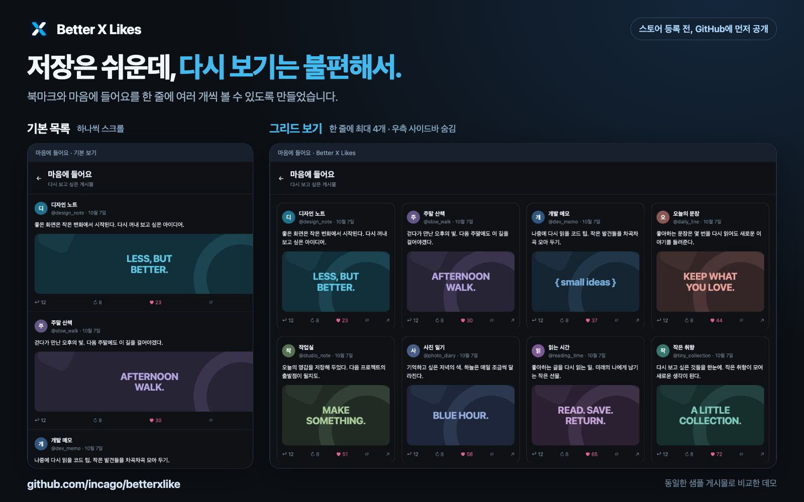
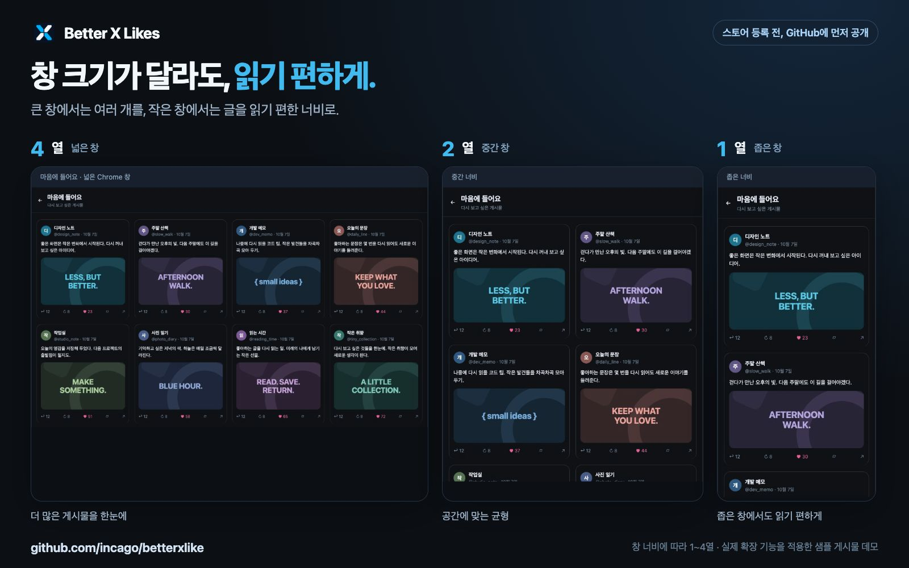

# 저장해 둔 X 게시물을 한눈에: Better X Likes를 소개합니다

X를 사용하다 보면 나중에 다시 보고 싶은 게시물을 자주 만나게 됩니다. 흥미로운 개발 이야기, 참고할 만한 디자인, 읽어 두고 싶은 글, 재미있는 이미지까지. 북마크나 마음에 들어요를 눌러 두면 다시 찾아볼 수 있지만, 저장한 게시물이 많아질수록 목록을 살펴보는 일이 번거로워집니다.

저도 마음에 드는 게시물에 좋아요를 눌러 두고 나중에 다시 보는 편입니다. 그런데 저장한 내용을 꺼내 볼 때마다 조금 아쉬웠습니다. 큰 모니터를 쓰고 있어도 게시물은 좁은 한 줄 목록으로 이어지고, 원하는 내용을 찾으려면 계속 아래로 내려야 했습니다.

“이 넓은 화면에서 게시물을 한 줄에 여러 개 볼 수 있으면 좋겠다.”

**Better X Likes**는 이 작은 불편에서 시작한 Chrome 확장 프로그램입니다. X의 게시물 목록을 화면 너비에 맞는 **1~4열 그리드**로 바꿔, 여러 게시물을 함께 훑어볼 수 있게 해 줍니다.



*위 이미지는 창작 샘플 게시물에 실제 확장 프로그램을 적용한 데모입니다.*

## 한 게시물씩 읽는 화면에서, 여러 게시물을 둘러보는 화면으로

X의 기본 목록은 게시물을 하나씩 읽으며 내려가기에 익숙한 형태입니다. 하지만 저장한 글을 다시 살펴볼 때는 조금 다른 방식으로 보게 됩니다. 처음부터 모든 글을 읽기보다, 이미지나 글의 첫 부분을 단서로 찾던 게시물을 고르거나 여러 자료를 빠르게 둘러보는 경우가 많습니다.

Better X Likes는 이때 화면의 가로 공간을 활용합니다. 넓은 창에서는 한 줄에 최대 네 개의 게시물을 보여 주고, 창을 줄이면 세 개, 두 개, 한 개로 자연스럽게 바뀝니다. 이미지가 있는 게시물을 모아 보거나, 저장해 둔 글의 내용을 훑으며 다시 읽을 대상을 고를 때 활용할 수 있습니다.

게시물을 별도로 복제해서 보여 주는 방식은 아닙니다. **X가 표시한 기존 게시물 요소에 스타일과 배치 처리를 적용**합니다. 그래서 게시물 안의 링크, 좋아요 버튼, 미디어 등 원래 요소와 클릭 동작을 유지하도록 구성했습니다. 확장 프로그램이 본문을 추가로 잘라내지도 않습니다.

## 원하는 화면에만 그리드를 적용할 수 있습니다

이름은 Better X Likes지만, 마음에 들어요 외에도 북마크, 홈, 검색 결과, 프로필을 지원합니다. 다만 모든 화면을 같은 방식으로 바꿀 필요는 없다고 생각했습니다. 홈에서는 익숙한 목록으로 읽고, 저장한 게시물을 다시 보는 화면에서만 그리드를 쓰고 싶을 수도 있기 때문입니다.

팝업에서 다섯 화면의 보기 방식을 각각 선택할 수 있습니다.

| 화면 | 처음 설치했을 때의 기본 보기 | 활용 예시 |
| --- | --- | --- |
| 북마크 | 그리드 | 나중에 읽으려고 모아 둔 게시물 둘러보기 |
| 마음에 들어요 | 그리드 | 좋아요를 눌러 둔 글과 이미지 다시 찾기 |
| 홈 | 기본 목록 | 평소에는 목록으로 읽고, 필요할 때 그리드로 전환하기 |
| 검색 결과 | 기본 목록 | 검색으로 찾은 여러 게시물 함께 살펴보기 |
| 프로필 | 기본 목록 | 특정 계정의 게시물 모아 보기 |

**처음 설치하면 북마크와 마음에 들어요만 그리드로 시작합니다.** 홈·검색·프로필은 팝업에서 원할 때 켜면 됩니다. 프로필 설정은 내 프로필과 다른 사람의 프로필에 공통으로 적용되며, 게시물·답글·미디어·하이라이트 목록을 지원합니다.

전체 기능을 켜고 끄는 스위치도 있습니다. 잠깐 기본 화면으로 돌아가고 싶을 때 이 스위치를 끄면 되고, 다시 켜면 저장해 둔 화면별 선택을 사용합니다. 설정은 같은 브라우저에 저장되어 열린 X 탭에도 반영됩니다.

## 창 크기에 맞춰 1~4열로 바뀝니다

그리드의 열 수는 브라우저 창 전체가 아니라 **게시물 목록이 실제로 사용할 수 있는 콘텐츠 영역의 너비**를 기준으로 결정됩니다.

| 콘텐츠 영역 너비 | 한 줄에 표시하는 게시물 수 |
| --- | --- |
| 1,060px 이상 | 4개 |
| 800px 이상, 1,060px 미만 | 3개 |
| 540px 이상, 800px 미만 | 2개 |
| 540px 미만 | 1개 |

예를 들어 넓은 모니터에서는 네 열로 둘러보다가, 브라우저를 다른 창 옆에 배치하면 가용 공간에 맞춰 열 수가 줄어듭니다. 좁은 창에서는 한 열로 표시해 게시물이 지나치게 가늘어지지 않도록 했습니다. 창 크기를 바꿀 때마다 별도의 설정을 조정할 필요는 없습니다.



*같은 샘플 게시물을 서로 다른 창 너비에서 표시한 데모입니다.*

그리드가 적용된 화면에서는 오른쪽의 검색·트렌드·팔로우 사이드바를 숨기고, 그 공간을 게시물 목록에 사용합니다. 왼쪽 탐색 메뉴는 유지합니다. 게시물 사이에 들어오는 팔로우 추천 영역도 그리드에서 숨기되, 게시물 안의 계정 표시나 로딩·오류 재시도 UI는 유지하도록 처리했습니다.

X의 라이트 모드와 다크 모드 색상을 따르기 때문에, 사용하던 테마에 맞춰 볼 수 있습니다.

## 영상은 보고 싶을 때 직접 재생합니다

여러 게시물을 한 화면에 보여 주면 영상도 여러 개가 함께 나타날 수 있습니다. 이때 자동재생이 시작되면 저장한 내용을 차분하게 둘러보기 어렵습니다.

그래서 **그리드 안의 영상은 직접 재생을 요청했을 때만 재생하도록** 했습니다. 영상 플레이어를 누르거나 키보드로 재생을 실행하면 해당 영상을 볼 수 있습니다. 게시물 본문을 누르거나 좋아요 버튼을 누르는 동작은 영상 재생 요청으로 취급하지 않습니다.

구현할 때는 재생된 영상을 계속 멈추는 것만으로는 충분하지 않았습니다. 사이트에서 재생을 반복해서 시도하면, 재생과 정지가 짧은 간격으로 이어질 수 있기 때문입니다. 현재는 그리드 안에서 사용자의 재생 요청 없이 호출되는 `play()`를 재생 시작 전에 차단하는 처리를 사용합니다.

이 영상 제어는 그리드가 적용된 게시물 목록에 한정됩니다. 화면을 기본 목록으로 바꾸거나 전체 스위치를 끄면 X의 기본 영상 재생 동작으로 돌아갑니다.

## 구현하면서 가장 신경 쓴 부분: 스크롤과 원래 동작 유지

겉으로 보면 게시물을 여러 열로 배치하는 기능이지만, 실제로는 CSS만 바꾸고 끝내기 어려운 부분이 있었습니다. X의 타임라인은 모든 게시물을 한꺼번에 화면에 두지 않고, 스크롤 위치에 따라 필요한 항목을 만들거나 제거하는 **가상 스크롤**을 사용하기 때문입니다.

화면에 보이는 몇 개의 게시물을 그리드로 바꾸는 것과, 아래로 계속 내려가도 새 게시물이 정상적으로 나타나게 하는 것은 다른 문제였습니다. 확장 프로그램이 목록의 전체 높이나 게시물의 세로 위치를 임의로 바꾸면 X가 다음 항목을 불러오는 계산과 충돌할 수 있습니다.

이를 다루기 위해 일반 목록과 가상 목록의 배치 방식을 구분했습니다. 일반 목록에는 CSS Grid를 적용하고, 가상 목록에서는 **X가 관리하는 전체 높이와 셀의 세로 좌표를 유지하면서 카드가 보이는 위치와 측정 높이를 조정**합니다. 게시물 요소를 다른 곳으로 옮기거나 복제하지 않는 것도 원래 이벤트와 화면 상태를 유지하기 위한 선택입니다.

새 게시물이 나타나거나 이미지·영상 때문에 카드 높이가 바뀌는 경우에도 배치를 다시 계산합니다. X 내부에서 페이지를 이동하는 상황을 감지하고, 그리드를 사용하지 않는 화면으로 나가면 확장 프로그램이 적용한 스타일과 영상 제어 상태를 복원합니다.

프로필에서는 게시물 목록을 넓히는 동시에 배너와 프로필 사진이 과도하게 커지지 않도록 별도로 처리했습니다. 넓어진 목록에 맞춰 상단 정보도 가로 공간을 사용하되, 배너와 사진의 높이·크기를 제한해 균형을 유지합니다.

## 설정은 브라우저에, 게시물은 X에

Better X Likes는 별도의 계정 가입이나 API 키 없이 사용할 수 있습니다. Chrome 확장 프로그램의 Manifest V3 구조를 사용하며, 다운로드한 실행 파일을 불러오는 데 빌드 과정도 필요하지 않습니다.

확장 프로그램이 저장하는 것은 **전체 켜기·끄기와 화면별 보기 설정**입니다. 이 설정은 `chrome.storage.local`에 보관합니다. 게시물의 식별자·크기·배치 순서와 영상 재생 제어 상태는 화면을 구성하기 위해 페이지 메모리에서 일시적으로 처리하며, 확장 프로그램 저장소에 게시물 내용을 보관하지 않습니다.

프로젝트에는 사용자 데이터를 외부로 보내는 별도 서버, 분석 도구, 광고 SDK나 추적 코드가 없습니다. X가 로그인이나 게시물 로딩, 영상 스트리밍을 위해 하는 통신은 X 서비스 자체의 동작입니다.

설정을 저장하기 위해 `storage` 권한을 사용하고, 콘텐츠 스크립트는 `x.com`과 `twitter.com`에서 실행됩니다. 자세한 데이터 처리 범위는 [개인정보처리방침](https://incago.github.io/better-x-likes-privacy/)에서 확인할 수 있습니다.

## 한국어·영어·일본어를 지원합니다

팝업과 확장 프로그램 설명은 한국어, 영어, 일본어로 제공합니다. Chrome 인터페이스가 한국어 또는 일본어이면 해당 언어로 표시하고, 그 외에는 영어를 사용합니다.

언어가 달라져도 화면별 설정은 유지됩니다. 이 기능은 확장 프로그램의 인터페이스에 적용되며, X의 화면이나 게시물 내용을 번역하는 기능은 아닙니다.

## 직접 사용해 보기

수동 설치는 다음 순서로 진행할 수 있습니다.

1. [GitHub 저장소](https://github.com/incago/betterxlike)의 README에서 설치용 ZIP을 내려받고 압축을 풉니다.
2. Chrome 주소창에 `chrome://extensions`를 입력합니다.
3. 오른쪽 위의 **개발자 모드**를 켭니다.
4. **압축해제된 확장 프로그램을 로드합니다**를 누르고, 압축을 푼 폴더 중 `manifest.json`이 있는 폴더를 선택합니다.
5. 이미 열려 있는 X 탭을 한 번 새로고침합니다.
6. 로그인한 상태에서 북마크나 마음에 들어요 목록을 열어 그리드 보기를 확인합니다.

툴바에 확장 프로그램을 고정하면 보기 설정을 쉽게 열 수 있습니다. 홈·검색·프로필에도 적용하고 싶다면 팝업에서 해당 화면을 **그리드**로 선택하면 됩니다. 업데이트한 뒤에도 확장 프로그램과 열려 있는 X 탭을 새로고침해야 변경된 코드가 적용됩니다.

소스 코드를 살펴보거나 로컬 샘플을 실행해 보고 싶은 분들을 위해 테스트와 미리보기 환경도 함께 제공합니다.

```sh
npm ci
npm test
npm run preview
```

미리보기를 실행한 뒤 `http://127.0.0.1:4173/i/history/likes`에 접속하면 실제 X 계정과 연결하지 않는 샘플 게시물로 화면을 확인할 수 있습니다. 브라우저 동작을 검증하는 Playwright 테스트도 별도로 포함되어 있습니다.

테스트에서는 열 수에 따른 배치, 그리드 해제 후 복원, 동적 게시물 추가, 가상 스크롤, 홈의 새 게시물 갱신, 프로필 상단, 영상 재생 제어, 세 언어의 설정 저장 등을 다룹니다. DOM 테스트와 브라우저 테스트는 GitHub Actions에서도 실행하도록 구성했습니다.

## 사용하면서 참고할 점

Better X Likes는 X의 기존 화면 구조에 적용되는 확장 프로그램입니다. 따라서 X가 내부 DOM 구조나 타임라인 측정 방식을 바꾸면 일부 동작에 영향을 받을 수 있습니다. 로컬 샘플과 자동 테스트로 여러 상황을 검증하고 있지만, 실제 로그인한 X에서의 무한 스크롤과 각 화면의 동작은 별도의 확인이 필요합니다.

지원하는 게시물 목록에서만 그리드를 적용하며, 게시물 상세·메시지·알림·탐색·팔로워 목록과 게시물이 없는 화면은 기본 레이아웃을 유지합니다. 문제가 생기면 팝업에서 그리드를 끄고 X 탭을 새로고침해 기본 보기로 돌아갈 수 있습니다.

이 프로젝트는 X Corp.의 공식 제품이 아닌 독립 확장 프로그램입니다.

## 저장한 게시물을 다시 꺼내 보기 편하게

Better X Likes를 만들면서 바꾸고 싶었던 것은 저장한 게시물을 다시 둘러보는 경험이었습니다. 좋아요나 북마크로 모아 둔 내용을 넓은 화면에서 함께 보고, 관심 있는 글을 골라 읽고, 필요한 영상만 직접 재생할 수 있게 하고 싶었습니다.

저처럼 X에서 글과 이미지를 자주 저장해 두는 분, 큰 화면의 공간을 더 활용하고 싶은 분, 특정 계정이나 검색 결과를 여러 게시물씩 둘러보고 싶은 분이라면 한번 사용해 보셔도 좋겠습니다.

코드와 설치 안내는 [GitHub의 Better X Likes 저장소](https://github.com/incago/betterxlike)에 공개되어 있습니다. 사용하면서 발견한 불편이나 개선 아이디어는 [GitHub Issues](https://github.com/incago/betterxlike/issues)로 남겨 주세요. 실제로 어떤 화면에서 도움이 되고, 어떤 부분이 어색한지 알려 주시면 다음 개선에 참고하겠습니다.

*이 글은 저장소의 1.5.10 버전 구현과 문서를 기준으로 작성했습니다.*
